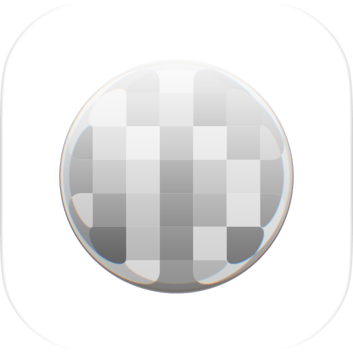

# 码住



原生 macOS 批量图片打码工具，使用 Swift、SwiftUI 和 AppKit 构建。导入一批图片，逐张涂抹、确认，最后统一导出。图片在本机处理，无需上传服务器。

[下载最新版本](https://github.com/wzuivcsyuiopas-cmd/mazhu/releases/latest) · [GPL-3.0 许可证](LICENSE)

Windows 原生版已建立 [WinUI 3 / Win2D 初版源码](windows/README.md)，尚待 Windows 编译和实机验证；当前下载发行版仍为 macOS 版。

## 功能

- 批量导入图片、拖入文件，或用 **⌘V** 粘贴图片。
- 马赛克、画笔、圈选、直线、高斯模糊五种工具。
- 圈选区域可填充马赛克或高斯模糊；画笔支持圆形、方形、颜色和不透明度。
- 侧栏支持框选、⌘／⇧ 多选与拖动排序，显示处理状态和图片分辨率。
- 撤销、重做、缩放和滚轮快捷调整。
- 本地保存原图、笔画和完成状态；退出后可继续编辑。
- 已确认图片可批量导出为 PNG 或 ZIP，保留像素尺寸。

## 系统要求

当前发行版面向 **Apple Silicon Mac，macOS 26 或更高版本**。部分 macOS 27 玻璃交互使用运行时能力检测，在较早版本上采用可用的原生控件行为。

下载的 App 使用临时签名（ad-hoc），未经过 Apple Developer ID 签名或公证。首次运行可能被 Gatekeeper 拦截；也可以从源码自行构建。

## 使用

1. 用 **⌘O** 批量导入，或直接拖入、粘贴图片。
2. 选择工具，在图片上拖动打码；左下角调整参数。
3. 按回车确认当前图片并进入下一张。
4. 通过右上角导出菜单导出已确认的图片。

| 快捷操作 | 功能 |
| --- | --- |
| ⌘V | 从剪贴板导入 |
| ⌘Z / ⇧⌘Z | 撤销 / 重做 |
| ← / → | 上一张 / 下一张 |
| 回车 | 确认并下一张 |
| ⌘0 / ⌘1 | 适应窗口 / 实际大小 |
| ⌘ + 滚轮 | 以鼠标位置为中心缩放 |
| ⌥ + 滚轮 | 调整笔刷、线宽或圈选参数 |
| ⌥⇧ + 滚轮 | 调整颗粒、不透明度或模糊强度 |

参数快捷键会随当前工具切换，完整说明可在“图片 → 滚轮快捷操作”中查看。

**遮盖敏感信息时，建议使用完全不透明的画笔。** 马赛克、模糊和半透明涂抹不能保证隐藏内容无法被推测。

## 从源码构建

需要 Apple Silicon Mac、支持 macOS 26 SDK 的 Xcode 或 Command Line Tools。当前构建脚本以 `arm64-apple-macos26.0` 为目标；没有第三方 Swift 依赖。

```sh
git clone https://github.com/wzuivcsyuiopas-cmd/mazhu.git
cd mazhu
./scripts/check.sh
./scripts/build.sh
open dist/码住.app
```

默认中间文件位于 `.build-local/`，App 位于 `dist/码住.app`。可通过 `TUMA_BUILD_DIR`、`TUMA_APP_PATH` 覆盖路径。`Package.swift` 可用于在 Xcode 中浏览和开发；生成完整 App 包请使用构建脚本。

`check.sh` 在独立临时目录使用自动生成的图片，检查渲染、历史恢复、剪贴板、批量操作、导出和部分 AppKit 行为，不读取用户工作区。

## 本地数据

为兼容改名前的版本，应用标识沿用 `local.tuma.native`，工作区保存在：

```text
~/Library/Application Support/TuMa/
```

其中包含导入的原图和编辑记录。不要把这个目录提交到仓库或附到公开问题中；反馈问题时请使用可以公开的示例图片。

## 源码结构

- `Sources/TuMa/`：界面、图像处理、工作区和窗口行为。
- `Tests/CoreChecks.swift`：核心回归检查。
- `scripts/`：检查和打包脚本。
- `IconDesign/`：当前 7×7 图标的素材与渲染配方。

## 贡献与许可

欢迎提交问题和 Pull Request，参与方式见 [CONTRIBUTING.md](CONTRIBUTING.md)。

Copyright © 2026 码住 contributors。项目按 **GNU GPL version 3 only（GPL-3.0-only）** 发布，完整条款见 [LICENSE](LICENSE)。第三方工具来源见 [NOTICE.md](NOTICE.md)。
